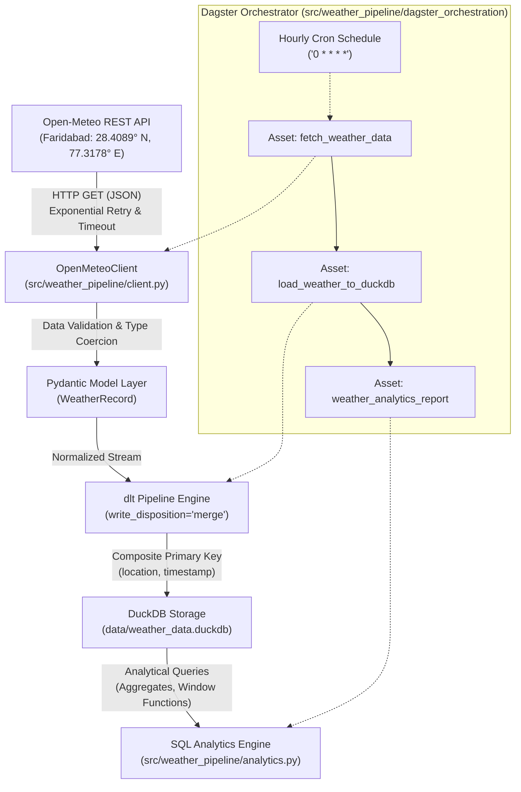

# System Architecture & Technical Design Document

## Weather Data Ingestion & Analytics Pipeline

### 1. Executive Summary
This project implements an enterprise-grade, automated data engineering pipeline designed to ingest, validate, store, and analyze weather observations for **Faridabad, Haryana, India** (Coordinates: `28.4089° N, 77.3178° E`).

The pipeline uses modern data stack principles:
- **Source**: Open-Meteo REST API (free, open-access, zero API key requirement).
- **Ingestion & Schema Evolution**: `dlt` (data load tool) with automated type inference and merge disposition.
- **Storage Engine**: `DuckDB` (embedded, serverless, fast columnar OLAP database).
- **Analytics Layer**: Standard SQL analytical queries leveraging window functions and aggregates.
- **Orchestration**: `Dagster` with software-defined assets, execution logging, and automated hourly scheduling.

---

### 2. High-Level Architecture Diagram

---

### 3. Core Architectural Components

#### 3.1. Resilient API Ingestion Layer (`client.py`)
- **HTTP Transport**: Built using Python `requests.Session` wrapped with `urllib3.util.Retry`.
- **Fault-Tolerance**: Automatically retries on HTTP 429 (rate limit) and transient 5xx server errors (`500, 502, 503, 504`) with configurable exponential backoff.
- **Schema Validation**: Open-Meteo payload is parsed and validated using Pydantic models. Unrealistic physical measurements (e.g., temperatures above 65°C or negative wind speeds) are trapped before reaching the database.
- **Missing Value Handling**: Incomplete hourly readings or sensor missing values are handled gracefully without aborting the batch.

#### 3.2. Idempotent Ingestion & Deduplication (`pipeline.py`)
- **Storage Target**: DuckDB database located at `data/weather_data.duckdb`.
- **Deduplication Strategy**: Uses `dlt` declarative resource schema with:
  - `primary_key = ["location", "timestamp"]`
  - `write_disposition = "merge"`
- **Historical Preservation**: Every execution merges the latest hourly data and current observation into DuckDB. If an observation for `2026-10-19T14:00` already exists, `dlt` updates the row in-place rather than inserting duplicate records. Historical data across previous days is preserved perpetually.

#### 3.3. Columnar OLAP Storage & SQL Analytics (`DuckDB` & `sql/`)
- DuckDB provides in-process columnar execution optimized for analytical aggregation queries.
- **Analytics Queries**:
  1. `recent_readings.sql`: Retrieves the latest 24 observations sorted chronologically descending.
  2. `temperature_stats.sql`: Computes daily average, minimum, maximum temperatures, and diurnal ranges in both Celsius and Fahrenheit.
  3. `humidity_wind_stats.sql`: Analyzes humidity levels, Beaufort-scale wind strength categorizations, and comfort indexes.
  4. `historical_trends.sql`: Employs SQL window functions (`AVG() OVER (ROWS BETWEEN 5 PRECEDING AND CURRENT ROW)` and `LAG()`) to compute 6-hour moving averages and temperature trends (Warming, Cooling, Stable).

#### 3.4. Orchestration & Observability (`Dagster`)
- **Software-Defined Assets (SDAs)**:
  - `fetch_weather_data`: Pulls live data from Open-Meteo API.
  - `load_weather_to_duckdb`: Loads records into DuckDB via dlt.
  - `weather_analytics_report`: Runs SQL analytics and logs summary metadata directly to the Dagster UI.
- **Scheduling**: `hourly_weather_schedule` triggers `weather_ingestion_job` at minute 0 of every hour (`0 * * * *`) in the `Asia/Kolkata` timezone.
- **UI & Observability**: Dagster provides a web UI (`dagster dev`) showing asset lineage, execution logs, run history, and asset materialization metadata.

---

### 4. Database Schema Specification

Table: `weather_analytics.weather_readings`

| Column Name | Data Type | Nullable | Primary Key | Description |
|:---|:---|:---:|:---:|:---|
| `location` | `VARCHAR` | No | Yes | Name of city and region ("Faridabad, Haryana, India") |
| `latitude` | `DOUBLE` | No | No | Latitude coordinate (`28.4089`) |
| `longitude` | `DOUBLE` | No | No | Longitude coordinate (`77.3178`) |
| `timestamp` | `VARCHAR` | No | Yes | ISO 8601 observation timestamp (`YYYY-MM-DDTHH:MM`) |
| `temperature_c` | `DOUBLE` | Yes | No | Surface temperature in Celsius |
| `temperature_f` | `DOUBLE` | Yes | No | Converted temperature in Fahrenheit |
| `relative_humidity_pct` | `DOUBLE` | Yes | No | Relative humidity (0 - 100%) |
| `wind_speed_kmh` | `DOUBLE` | Yes | No | Wind speed at 10m in km/h |
| `wind_speed_ms` | `DOUBLE` | Yes | No | Wind speed in meters per second |
| `weather_code` | `BIGINT` | Yes | No | WMO weather condition code |
| `weather_description` | `VARCHAR` | Yes | No | Human-readable condition (e.g. "Clear sky", "Partly cloudy") |
| `is_day` | `BIGINT` | Yes | No | Daytime indicator (1 for day, 0 for night) |
| `ingested_at` | `VARCHAR` | No | No | UTC timestamp when row was loaded |
